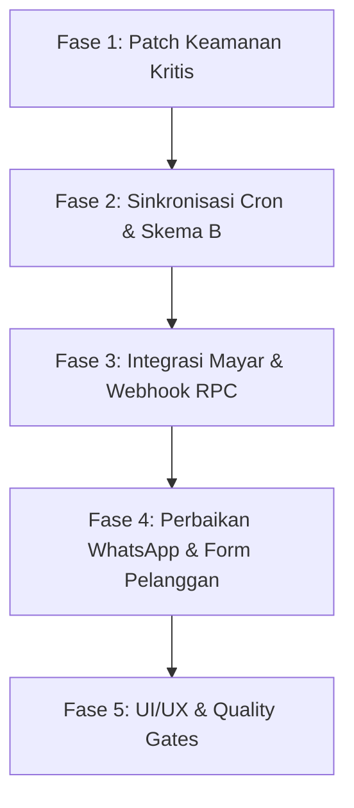

# BEATNET — AUDIT REMEDIATION & ACTION PLAN
**Dokumen:** Rencana Perbaikan & Sinkronisasi Kode dengan Database Supabase  
**Tanggal Audit:** 17 Oktober 2026  
**Status:** Siap Dikerjakan (Ready for Execution)  
**Dokumen Acuan:** `PRD.md`, `DATABASE-DESIGN.md`, `SECURITY-STANDARD.md`, `CODING-STANDARDS.md`, `DESIGN-BRIEF.md`, `IMPLEMENTATION-ROADMAP.md`

---

## 1. Executive Summary

Audit kode dan inspeksi *live* ke database Supabase (`efazqkjunikuqshrdufd.supabase.co`) menunjukkan:

1. **Kondisi Database Supabase Saat Ini:**
   * Terdapat **138 data pelanggan aktif** (cocok dengan target PRD ~140 pelanggan).
   * Terdapat **276 data tagihan**.
   * Tabel `payment_attempts` dan kolom pendukung Mayar (`gateway_provider`, `gateway_order_id`, `customer_fee`, `settlement_time`, `payment_metadata`) **sudah dibuat di Supabase**.
   * Kolom koordinat (`latitude`, `longitude`) **sudah ada di tabel `pelanggan`**, namun masih bernilai `NULL` karena form frontend belum mendukungnya.
   * **Stored Procedure (RPC) Siap Pakai di Supabase:**
     * `generate_tagihan_harian_skema_b(p_tanggal_hari_ini, p_bulan, p_tahun)` $\rightarrow$ Sudah ada, belum dipanggil oleh cron.
     * `mark_overdue_tagihan(p_business_date)` $\rightarrow$ Sudah ada, belum ada cron yang mengeksekusinya.
     * `process_gateway_payment(...)` $\rightarrow$ Sudah ada, belum dihubungkan ke webhook.
2. **Kondisi Kode Aplikasi (Next.js):**
   * Masih menggunakan library Midtrans Snap dan kode prototipe lama.
   * Ditemukan beberapa celah keamanan berisiko tinggi (*Critical/High*) yang wajib segera ditutup.
   * Pengiriman WhatsApp tagihan di cron di-*return early* (dinonaktifkan).
   * Template WhatsApp masih mengarahkan pelanggan untuk transfer manual ke rekening pribadi.

---

## 2. Checklist Rencana Aksi (Action Plan Checklist)



---

### FASE 1: Patch Keamanan Mendesak (Urgent Security Patches)

- [x] **1.1. Perbaiki Celah Bypass Autentikasi Cron Job**
  * **File Terkait:**
    * `app/api/cron/generate-tagihan/route.js`
    * `app/api/cron/kirim-tagihan/route.js`
    * `app/api/cron/notif-tagihan/route.js`
  * **Masalah:** Kondisi `if (process.env.CRON_SECRET && authHeader && ...)` mengizinkan siapa pun memicu cron jika request dikirim tanpa header `Authorization`.
  * **Solusi Perbaikan:**
    ```javascript
    // Ganti logika pengecekan menjadi:
    const authHeader = request.headers.get('authorization');
    const expectedSecret = process.env.CRON_SECRET;
    
    if (!expectedSecret || authHeader !== `Bearer ${expectedSecret}`) {
        return NextResponse.json({ error: 'Unauthorized: Invalid or missing token' }, { status: 401 });
    }
    ```

- [x] **1.2. Kunci Celah Open WhatsApp Relay / SMS Bombing**
  * **File Terkait:**
    * `app/api/wa/kirim/route.js`
    * `app/api/wa/blast-wilayah/route.js`
    * `app/api/bulk/wa/route.js`
  * **Masalah:** Siapa pun di internet dapat melakukan POST ke endpoint ini untuk mengirim pesan WhatsApp gratis memakai kuota Fonnte pemilik sistem.
  * **Solusi Perbaikan:** Pasang otentikasi sesi Supabase di awal handler:
    ```javascript
    import { createServerClient } from '@supabase/ssr';
    import { cookies } from 'next/headers';

    const cookieStore = await cookies();
    const supabase = createServerClient(
        process.env.NEXT_PUBLIC_SUPABASE_URL,
        process.env.NEXT_PUBLIC_SUPABASE_ANON_KEY,
        { cookies: { getAll: () => cookieStore.getAll() } }
    );
    const { data: { user } } = await supabase.auth.getUser();
    if (!user) {
        return NextResponse.json({ error: 'Forbidden: Admin access required' }, { status: 403 });
    }
    ```

- [x] **1.3. Kunci Celah Price Tampering di Payment Creation**
  * **File Terkait:** `app/api/payment/create/route.js`
  * **Masalah:** Menerima parameter `jumlah` dari body JSON tanpa mencocokkannya ke database.
  * **Solusi Perbaikan:**
    1. Ambil data tagihan langsung dari database:
       ```javascript
       const { data: tagihan, error } = await supabaseAdmin
           .from('tagihan')
           .select('id, jumlah_tagihan, status_pembayaran, pelanggan:pelanggan_id(nama, no_wa)')
           .eq('id', tagihan_id)
           .single();
       ```
    2. Validasi status tagihan (hanya buat link jika statusnya `belum_bayar` atau `UNPAID`).
    3. Gunakan `tagihan.jumlah_tagihan` murni dari database sebagai nominal dasar transaksi.

- [x] **1.4. Amankan Operasi Massal (Bulk Action)**
  * **File Terkait:**
    * `app/api/bulk/tagihan/route.js`
    * `app/api/bulk/pelanggan/route.js`
  * **Solusi Perbaikan:**
    1. Wajibkan autentikasi sesi admin.
    2. Hapus opsi `action === 'delete'` pada tagihan (ganti dengan pembatalan/soft cancel, bukan hapus permanen dari basis data).

- [x] **1.5. Aktifkan Middleware Next.js (`proxy.js` $\rightarrow$ `middleware.js`)**
  * **File Terkait:** `proxy.js`
  * **Solusi Perbaikan:**
    1. Ganti nama `proxy.js` menjadi `middleware.js` di root repository.
    2. Perbarui matcher agar melindungi seluruh route administratif:
       ```javascript
       export const config = {
           matcher: [
               '/dashboard/:path*',
               '/login',
               '/api/bulk/:path*',
               '/api/wa/:path*'
           ],
       };
       ```

- [x] **1.6. Hapus Endpoint Pembocor Server Key**
  * **File Terkait:** `app/api/test-midtrans/route.js`
  * **Solusi Perbaikan:** Hapus file ini sepenuhnya dari repositori.

- [x] **1.7. Lengkapi Kebijakan RLS di Supabase**
  * **Tabel Terkait di Supabase:** `public.paket`, `public.pengeluaran`, `public.log_notifikasi`.
  * **Solusi Perbaikan:** Jalankan query SQL di Supabase SQL Editor:
    ```sql
    ALTER TABLE public.pengeluaran ENABLE ROW LEVEL SECURITY;
    CREATE POLICY "Admin only access to pengeluaran" ON public.pengeluaran
        FOR ALL TO authenticated USING (true) WITH CHECK (true);

    ALTER TABLE public.log_notifikasi ENABLE ROW LEVEL SECURITY;
    CREATE POLICY "Admin only access to log_notifikasi" ON public.log_notifikasi
        FOR ALL TO authenticated USING (true) WITH CHECK (true);
    ```

---

### FASE 2: Sinkronisasi Billing Engine & Cron (Skema B)

- [x] **2.1. Hubungkan Cron Penagihan Harian ke `generate_tagihan_harian_skema_b`**
  * **File Terkait:** `app/api/cron/generate-tagihan/route.js`
  * **Langkah Pengerjaan:**
    1. Hitung tanggal hari ini dalam zona waktu WIB (`Asia/Jakarta`).
    2. Panggil RPC Supabase yang sudah tersedia:
       ```javascript
       const { data, error } = await supabaseAdmin.rpc('generate_tagihan_harian_skema_b', {
           p_tanggal_hari_ini: tanggalWib, // integer 1-28
           p_bulan: bulanWib,
           p_tahun: tahunWib,
       });
       ```
    3. Cron ini hanya menagih pelanggan yang `status = 'aktif'` dan `tanggal_jatuh_tempo = tanggalWib` (rata-rata terdistribusi ~4–5 pelanggan per hari sesuai PRD Skema B).

- [x] **2.2. Buat Cron Overdue Otomatis (Toleransi 3 Hari)**
  * **File Baru:** `app/api/cron/overdue/route.js`
  * **Jadwal Eksekusi:** Setiap pukul 00:05 WIB.
  * **Langkah Pengerjaan:**
    1. Ambil tanggal hari ini dalam format `YYYY-MM-DD` (WIB).
    2. Panggil RPC yang sudah ada di Supabase:
       ```javascript
       const { data, error } = await supabaseAdmin.rpc('mark_overdue_tagihan', {
           p_business_date: tanggalHariIniWib,
       });
       ```
    3. Status tagihan yang melewati batas jatuh tempo otomatis berubah menjadi `overdue`.

- [x] **2.3. Aktifkan Pengiriman WhatsApp di Cron Tagihan**
  * **File Terkait:** `app/api/cron/kirim-tagihan/route.js`
  * **Solusi Perbaikan:**
    1. Hapus baris 23–29 yang menangguhkan pengiriman WA.
    2. Pastikan pesan memuat link pembayaran resmi Mayar yang sudah digenerate.

---

### FASE 3: Rombak Integrasi Payment Gateway (Midtrans $\rightarrow$ Mayar)

- [x] **3.1. Buat Service Adapter Mayar (`lib/mayar.js`)**
  * **Fitur:**
    * Membuat *Single Payment Request* (`POST https://api.mayar.id/hl/v2/payment/request/single`).
    * Menetapkan masa berlaku expired tepat 3 hari kalender sesuai `due_date`.
    * Memvalidasi signature HMAC-SHA256 untuk webhook Mayar.
  * **Logika Split Fee 70/30 (PRD FR-3.4):**
    ```javascript
    // Estimasi biaya transaksi standar (misal QRIS flat Rp 800 atau 0.7%)
    const gatewayFeeEstimate = 800; // IDR
    const customerFee = Math.ceil(gatewayFeeEstimate * 0.30); // 30% dibebankan ke user
    const adminFee = gatewayFeeEstimate - customerFee;        // 70% diserap admin
    const totalAmount = Number(basePrice) + customerFee;
    ```

- [x] **3.2. Perbarui `POST /api/payment/create`**
  * **File Terkait:** `app/api/payment/create/route.js`
  * **Langkah Pengerjaan:**
    1. Panggil fungsi adapter Mayar untuk membuat link pembayaran dengan nominal `totalAmount`.
    2. Catat ke tabel `payment_attempts` di Supabase:
       ```javascript
       await supabaseAdmin.from('payment_attempts').insert([{
           tagihan_id: tagihan.id,
           status: 'PENDING',
           provider: 'mayar',
           payment_url: mayarResponse.data.link,
           gateway_order_id: mayarResponse.data.id,
       }]);
       ```
    3. Update tabel `tagihan`:
       ```javascript
       await supabaseAdmin.from('tagihan').update({
           payment_url: mayarResponse.data.link,
           gateway_order_id: mayarResponse.data.id,
           gateway_provider: 'mayar',
           customer_fee: customerFee,
       }).eq('id', tagihan.id);
       ```

- [x] **3.3. Rombak Webhook Payment (`POST /api/payment/webhook`)**
  * **File Terkait:** `app/api/payment/webhook/route.js`
  * **Langkah Pengerjaan:**
    1. Tangkap *raw body* request dan header signature Mayar.
    2. Verifikasi signature dengan `crypto.timingSafeEqual` dan `MAYAR_WEBHOOK_SECRET`.
    3. Jika status event adalah `PAID` / `SETTLEMENT`:
       * Panggil RPC Supabase:
         ```javascript
         await supabaseAdmin.rpc('process_gateway_payment', {
             p_tagihan_id: tagihanId,
             p_event_id: eventId,
             p_reference: gatewayOrderId,
             p_amount: grossAmount,
             p_method: paymentMethod,
             p_paid_at: paidAtIsoString,
         });
         ```
    4. Tangani kasus **Duplicate Payment** (FR-8.4): Jika tagihan sebelumnya sudah dibayar tunai (`CASH`), jangan ditolak, tetapi update flag `duplicate_payment_flag = true` agar admin mendapat peringatan refund.

---

### FASE 4: Penyelarasan Template WhatsApp & Form Pelanggan

- [x] **4.1. Ubah Template Pesan WhatsApp Menjadi Format Resmi PRD**
  * **File Terkait:**
    * `app/api/cron/kirim-tagihan/route.js`
    * `app/api/cron/notif-tagihan/route.js`
    * `app/dashboard/tagihan/page.js`
  * **Format Baku (FR-5.2):**
    ```text
    Yth. Bapak/Ibu {nama_pelanggan},

    Berikut tagihan internet WiFi periode {periode_bulan} {tahun}:
    - Paket: {nama_paket} ({kecepatan} Mbps)
    - Total Tagihan: Rp {total_amount}
    - Batas Pembayaran: {due_date} (3 hari)

    Silakan lakukan pembayaran instan melalui tautan resmi berikut (Bisa QRIS, E-Wallet, atau Transfer Bank):
    {payment_link_url}

    *Pesan ini dikirim otomatis oleh sistem billing. Pembayaran akan terkonfirmasi secara instan tanpa perlu mengirim bukti transfer.*
    Terima kasih.
    ```

- [x] **4.2. Normalisasi Format Nomor WhatsApp**
  * **File Terkait:** `lib/whatsapp.js`
  * **Implementasi:** Seluruh nomor dipastikan berformat internasional tanpa spasi/simbol: `628xxxxxxxxxx`.

- [x] **4.3. Tambahkan Input Koordinat di Form Pelanggan**
  * **File Terkait:** `app/dashboard/pelanggan/page.js`
  * **Langkah Pengerjaan:**
    * Tambahkan input `Latitude` & `Longitude` pada modal tambah/edit pelanggan.
    * Sertakan tombol *"Gunakan Lokasi Saat Ini"* (Geolocation API browser) untuk memudahkan teknisi di lapangan mengisi titik koordinat rumah pelanggan.
    * Pastikan data tersimpan ke kolom `latitude` dan `longitude` yang sudah ada di tabel `pelanggan` Supabase.

- [x] **4.4. Amankan / Sederhanakan Rute Publik `/bayar/[id]`**
  * **File Terkait:** `app/bayar/[id]/page.js`
  * **Langkah Pengerjaan:** Karena PRD tidak memerlukan portal web pelanggan (pelanggan cukup membuka link Mayar), rute ini disederhanakan: jika diakses, langsung *redirect* ke `payment_url` Mayar atau hanya menampilkan status lunas/belum lunas tanpa membocorkan nomor HP dan alamat lengkap rumah.

---

### FASE 5: Standarisasi Kualitas Kode & Desain

- [x] **5.1. Sanitasi PII pada Log Terminal**
  * **File Terkait:** `lib/whatsapp.js`
  * **Implementasi:** Hapus `console.log` yang mencetak nomor telepon mentah, ganti dengan penyamaran: `nomor.slice(0, 5) + '*****'`.

- [x] **5.2. Penyelarasan Desain ke Arah *Warm Operational Finance***
  * **File Terkait:** `tailwind.config.js`, `app/globals.css`, `app/dashboard/layout.js`
  * **Implementasi:**
    * Tambahkan token warna Beatnet di Tailwind:
      * `brand-900`: `#123C3A`
      * `brand-700`: `#176B63`
      * `brand-100`: `#DDF3ED`
      * `surface-0`: `#FFFFFF`
      * `surface-50`: `#F7F9F7`
    * Gunakan font **Plus Jakarta Sans** untuk antarmuka dan **IBM Plex Mono** untuk angka nominal/ID.
    * Kurangi efek glow neon gelap agar dashboard nyaman dioperasikan oleh admin dari layar ponsel saat di lapangan.

---

## 3. Matriks Referensi File & Status Perbaikan

| Modul / Komponen | File Terkait | Masalah Utama Saat Ini | Target Kondisi Pasca-Perbaikan |
| :--- | :--- | :--- | :--- |
| **Cron Penagihan** | [`app/api/cron/generate-tagihan/route.js`](file:///c:/Users/ASUS/billing/app/api/cron/generate-tagihan/route.js) | Auth bypass & Skema A bulanan | Token strict & panggil `generate_tagihan_harian_skema_b` |
| **Cron Overdue** | *Belum ada file* | Tidak ada scheduler overdue | File baru memanggil `mark_overdue_tagihan` jam 00:05 WIB |
| **Cron WA Tagihan** | [`app/api/cron/kirim-tagihan/route.js`](file:///c:/Users/ASUS/billing/app/api/cron/kirim-tagihan/route.js) | Pengiriman WA dinonaktifkan | Hapus blok return early, kirim link Mayar |
| **Payment Creation** | [`app/api/payment/create/route.js`](file:///c:/Users/ASUS/billing/app/api/payment/create/route.js) | Midtrans Snap & Price Tampering | Mayar API, Split Fee 70/30, catat `payment_attempts` |
| **Payment Webhook** | [`app/api/payment/webhook/route.js`](file:///c:/Users/ASUS/billing/app/api/payment/webhook/route.js) | Midtrans SHA-512 & no RPC | Mayar HMAC-SHA256 & panggil `process_gateway_payment` |
| **Relay WhatsApp** | [`app/api/wa/kirim/route.js`](file:///c:/Users/ASUS/billing/app/api/wa/kirim/route.js) | Open relay publik tanpa auth | Wajib login sesi admin |
| **Bulk Actions** | [`app/api/bulk/tagihan/route.js`](file:///c:/Users/ASUS/billing/app/api/bulk/tagihan/route.js) | Hapus tagihan permanen tanpa auth | Wajib login admin & hilangkan hard delete |
| **Middleware** | [`proxy.js`](file:///c:/Users/ASUS/billing/proxy.js) | Nama file salah (tidak aktif) | Ganti nama ke `middleware.js` & lindungi dashboard |
| **Form Pelanggan** | [`app/dashboard/pelanggan/page.js`](file:///c:/Users/ASUS/billing/app/dashboard/pelanggan/page.js) | Tidak ada input latitude/longitude | Input koordinat GPS terhubung ke Supabase |
| **Template Notifikasi** | [`app/api/cron/notif-tagihan/route.js`](file:///c:/Users/ASUS/billing/app/api/cron/notif-tagihan/route.js) | Minta transfer ke Mandiri/DANA pribadi | Ganti format resmi PRD dengan tautan instan Mayar |

---

## 4. Panduan Eksekusi (Next Step)

Dokumen ini disimpan di file: [`c:\Users\ASUS\billing\AUDIT-REMEDIATION-PLAN.md`](file:///c:/Users/ASUS/billing/AUDIT-REMEDIATION-PLAN.md).

Pengerjaan disarankan dimulai secara berurutan dari **FASE 1 (Patch Keamanan Mendesak)**, dilanjutkan ke **FASE 2 (Sinkronisasi Cron)** dan **FASE 3 (Integrasi Mayar)**.
