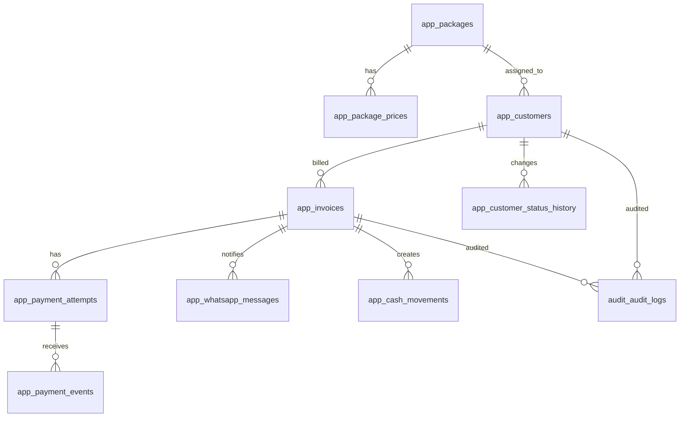

# Database Architecture & Schema Design

**Produk:** CRM & Billing RT/RW Net  
**Status:** Approved baseline sebelum implementasi  
**Target awal:** 1 admin, ~140 pelanggan; desain siap tumbuh ke multi-operator dan ribuan pelanggan.

## 1. Keputusan Arsitektur

Gunakan **PostgreSQL 16+ sebagai system of record**, satu database relasional dengan schema `app`, `audit`, dan `integration`. Gunakan **Redis** hanya sebagai cache/queue, bukan sumber kebenaran. Object storage S3-compatible digunakan untuk export dan backup terenkripsi, bukan untuk data transaksi.

Keputusan penting:

- Semua nominal disimpan sebagai `BIGINT` dalam Rupiah (bukan floating point/`money`), sehingga bebas error pembulatan.
- Semua waktu disimpan `timestamptz` dalam UTC; scheduler dan tampilan memakai `Asia/Jakarta`.
- Invoice menyimpan snapshot nama paket, harga, fee, dan total ketika diterbitkan. Perubahan harga paket tidak mengubah invoice lama.
- Satu invoice dapat memiliki beberapa payment attempt/payment event agar renewal, retry, dan pembayaran ganda terlacak tanpa overwrite histori.
- Webhook disimpan mentah dan diproses idempoten melalui unique key gateway-event.
- Data aplikasi dipisahkan dari audit dan event integrasi agar retention, akses, dan troubleshooting dapat dikontrol.

## 2. Entity Relationship & Data Model



### Cardinality

- `packages 1:N package_prices`: histori harga; hanya satu harga efektif pada satu waktu.
- `packages 1:N customers`: satu paket dapat dipakai banyak pelanggan; satu pelanggan memiliki satu paket aktif.
- `customers 1:N invoices`: satu invoice per pelanggan per tanggal billing; enforced dengan unique constraint.
- `invoices 1:N payment_attempts`: invoice awal dan link renewal memiliki attempt berbeda.
- `payment_attempts 1:N payment_events`: webhook bisa retry/duplicate; event immutable.
- `invoices 1:N whatsapp_messages`: pengiriman awal dan retry tercatat terpisah.
- `invoices 1:N cash_movements`: normalnya satu; dipisah untuk ledger dan refund/adjustment.
- Tidak ada N:M pada MVP. Jika multi-package di masa depan, gunakan tabel junction bertanggal efektif, bukan array/json.

## 3. PostgreSQL Schema Definition

Contoh berikut adalah definisi kanonik. UUID dibuat aplikasi atau `gen_random_uuid()` melalui `pgcrypto`.

```sql
CREATE EXTENSION IF NOT EXISTS pgcrypto;
CREATE SCHEMA IF NOT EXISTS app;
CREATE SCHEMA IF NOT EXISTS integration;
CREATE SCHEMA IF NOT EXISTS audit;

CREATE TYPE app.customer_status AS ENUM ('ACTIVE','INACTIVE');
CREATE TYPE app.invoice_status AS ENUM ('UNPAID','PAID','OVERDUE','CANCELLED');
CREATE TYPE app.payment_method AS ENUM ('QRIS','VA_BCA','VA_BRI','VA_BNI','VA_MANDIRI','EWALLET','RETAIL','CASH','OTHER');
CREATE TYPE app.attempt_status AS ENUM ('CREATED','PENDING','PAID','EXPIRED','FAILED','CANCELLED');
CREATE TYPE app.delivery_status AS ENUM ('QUEUED','SENT','FAILED');
CREATE TYPE app.cash_movement_type AS ENUM ('INCOME','EXPENSE','REFUND','ADJUSTMENT');
CREATE TYPE app.reconciliation_status AS ENUM ('PENDING','MATCHED','MISMATCH','NEEDS_REVIEW');
```

### `app.packages`

| Kolom                      | Tipe         | Null/default                 | Constraint       |
| -------------------------- | ------------ | ---------------------------- | ---------------- |
| `id`                       | uuid         | NOT NULL / gen_random_uuid() | PK               |
| `name`                     | varchar(100) | NOT NULL                     | non-empty        |
| `speed_mbps`               | integer      | NOT NULL                     | `> 0`            |
| `base_price_idr`           | bigint       | NOT NULL                     | `>= 0`           |
| `is_active`                | boolean      | NOT NULL / true              |                  |
| `created_at`, `updated_at` | timestamptz  | NOT NULL / now()             |                  |
| `deleted_at`               | timestamptz  | NULL                         | soft delete only |

`UNIQUE (lower(name)) WHERE deleted_at IS NULL`.

### `app.package_prices`

| Kolom            | Tipe        | Null/default                 | Constraint                      |
| ---------------- | ----------- | ---------------------------- | ------------------------------- |
| `id`             | uuid        | NOT NULL / gen_random_uuid() | PK                              |
| `package_id`     | uuid        | NOT NULL                     | FK packages RESTRICT            |
| `price_idr`      | bigint      | NOT NULL                     | `>= 0`                          |
| `effective_from` | date        | NOT NULL                     |                                 |
| `effective_to`   | date        | NULL                         | `effective_to > effective_from` |
| `created_at`     | timestamptz | NOT NULL / now()             |                                 |

Exclusion constraint pada `daterange(effective_from, coalesce(effective_to,'infinity'::date), '[)')` per package mencegah histori harga overlap.

### `app.customers`

| Kolom                      | Tipe            | Null/default                 | Constraint                      |
| -------------------------- | --------------- | ---------------------------- | ------------------------------- |
| `id`                       | uuid            | NOT NULL / gen_random_uuid() | PK                              |
| `customer_code`            | varchar(20)     | NOT NULL                     | UNIQUE, format `CUST-[0-9]{3,}` |
| `full_name`                | varchar(100)    | NOT NULL                     | trim, length 2..100             |
| `phone_whatsapp`           | varchar(15)     | NOT NULL                     | UNIQUE, format `628[0-9]{8,12}` |
| `address`                  | text            | NOT NULL                     | non-empty                       |
| `latitude`                 | numeric(9,6)    | NULL                         | -90..90                         |
| `longitude`                | numeric(9,6)    | NULL                         | -180..180                       |
| `package_id`               | uuid            | NOT NULL                     | FK packages RESTRICT            |
| `billing_cycle_day`        | smallint        | NOT NULL                     | 1..28                           |
| `status`                   | customer_status | NOT NULL / ACTIVE            |                                 |
| `activated_on`             | date            | NOT NULL                     |                                 |
| `deactivated_at`           | timestamptz     | NULL                         |                                 |
| `created_at`, `updated_at` | timestamptz     | NOT NULL / now()             |                                 |

Nomor dinormalisasi ke E.164 lokal Indonesia sebelum insert. Koordinat boleh sama-sama NULL, tetapi tidak boleh hanya salah satu yang terisi. `UNIQUE(phone_whatsapp)` berlaku untuk record aktif; riwayat nomor lama disimpan di `customer_phone_history` bila diperlukan.

### `app.invoices`

| Kolom                      | Tipe           | Null/default                 | Constraint                   |
| -------------------------- | -------------- | ---------------------------- | ---------------------------- |
| `id`                       | uuid           | NOT NULL / gen_random_uuid() | PK                           |
| `invoice_number`           | varchar(32)    | NOT NULL                     | UNIQUE, `INV/YYYYMM/XXXX`    |
| `customer_id`              | uuid           | NOT NULL                     | FK customers RESTRICT        |
| `package_id`               | uuid           | NOT NULL                     | FK packages RESTRICT         |
| `package_name_snapshot`    | varchar(100)   | NOT NULL                     |                              |
| `speed_mbps_snapshot`      | integer        | NOT NULL                     | > 0                          |
| `base_amount_idr`          | bigint         | NOT NULL                     | >= 0                         |
| `gateway_fee_estimate_idr` | bigint         | NOT NULL                     | >= 0                         |
| `customer_fee_idr`         | bigint         | NOT NULL                     | `ceil(fee*0.30)` hasil final |
| `admin_fee_idr`            | bigint         | NOT NULL                     | `fee - customer_fee`         |
| `total_amount_idr`         | bigint         | NOT NULL                     | `base + customer_fee`        |
| `billing_date`             | date           | NOT NULL                     |                              |
| `due_date`                 | date           | NOT NULL                     | `billing_date + 3 days`      |
| `status`                   | invoice_status | NOT NULL / UNPAID            |                              |
| `paid_at`                  | timestamptz    | NULL                         | wajib jika PAID              |
| `paid_method`              | payment_method | NULL                         | wajib jika PAID              |
| `paid_amount_idr`          | bigint         | NULL                         | > 0 jika terisi              |
| `duplicate_payment_flag`   | boolean        | NOT NULL / false             |                              |
| `created_at`, `updated_at` | timestamptz    | NOT NULL / now()             |                              |

`CHECK(total_amount_idr = base_amount_idr + customer_fee_idr)`, `CHECK(due_date = billing_date + 3)`, `CHECK((status='PAID') = (paid_at IS NOT NULL AND paid_method IS NOT NULL))`. Unique `(customer_id, billing_date)` mencegah scheduler membuat invoice ganda.

### `app.payment_attempts`

| Kolom                      | Tipe           | Null/default                 | Constraint          |
| -------------------------- | -------------- | ---------------------------- | ------------------- |
| `id`                       | uuid           | NOT NULL / gen_random_uuid() | PK                  |
| `invoice_id`               | uuid           | NOT NULL                     | FK invoices CASCADE |
| `gateway`                  | varchar(30)    | NOT NULL / `MAYAR`           |                     |
| `gateway_order_id`         | varchar(150)   | NOT NULL                     | UNIQUE(gateway, id) |
| `payment_url`              | text           | NOT NULL                     | URL valid           |
| `amount_idr`               | bigint         | NOT NULL                     | > 0                 |
| `expires_at`               | timestamptz    | NOT NULL                     | > created_at        |
| `status`                   | attempt_status | NOT NULL / CREATED           |                     |
| `created_at`, `updated_at` | timestamptz    | NOT NULL / now()             |                     |

### `app.payment_events`

| Kolom                         | Tipe           | Null/default                 | Constraint                         |
| ----------------------------- | -------------- | ---------------------------- | ---------------------------------- |
| `id`                          | uuid           | NOT NULL / gen_random_uuid() | PK                                 |
| `payment_attempt_id`          | uuid           | NULL                         | FK attempts SET NULL               |
| `invoice_id`                  | uuid           | NOT NULL                     | FK invoices RESTRICT               |
| `gateway`                     | varchar(30)    | NOT NULL                     |                                    |
| `external_event_id`           | varchar(200)   | NOT NULL                     | UNIQUE(gateway, external_event_id) |
| `external_transaction_id`     | varchar(150)   | NULL                         |                                    |
| `event_status`                | varchar(30)    | NOT NULL                     | raw gateway status                 |
| `gross_amount_idr`            | bigint         | NULL                         | >= 0                               |
| `gateway_fee_idr`             | bigint         | NULL                         | >= 0                               |
| `payment_method`              | payment_method | NULL                         |                                    |
| `signature_valid`             | boolean        | NOT NULL                     |                                    |
| `raw_payload`                 | jsonb          | NOT NULL                     | encrypted storage/strict ACL       |
| `received_at`, `processed_at` | timestamptz    | NOT NULL / now(), NULL       |                                    |
| `processing_error`            | text           | NULL                         |                                    |

Webhook transaction: verify signature, lock invoice `FOR UPDATE`, verify gateway reference and amount, insert event with `ON CONFLICT DO NOTHING`, then transition state. Event yang signature-invalid tetap disimpan dengan payload minimal untuk forensic; jangan diproses.

### `app.whatsapp_messages`

| Kolom                   | Tipe            | Null/default                 | Constraint          |
| ----------------------- | --------------- | ---------------------------- | ------------------- |
| `id`                    | uuid            | NOT NULL / gen_random_uuid() | PK                  |
| `invoice_id`            | uuid            | NOT NULL                     | FK invoices CASCADE |
| `target_phone`          | varchar(15)     | NOT NULL                     |                     |
| `template_key`          | varchar(60)     | NOT NULL                     |                     |
| `message_content`       | text            | NOT NULL                     |                     |
| `delivery_status`       | delivery_status | NOT NULL / QUEUED            |                     |
| `provider_message_id`   | varchar(150)    | NULL                         |                     |
| `attempt_count`         | smallint        | NOT NULL / 0                 | 0..5                |
| `last_error`            | text            | NULL                         |                     |
| `sent_at`, `created_at` | timestamptz     | NULL, NOT NULL / now()       |                     |

### `app.cash_movements`

| Kolom            | Tipe               | Null/default                 | Constraint             |
| ---------------- | ------------------ | ---------------------------- | ---------------------- |
| `id`             | uuid               | NOT NULL / gen_random_uuid() | PK                     |
| `invoice_id`     | uuid               | NULL                         | FK invoices RESTRICT   |
| `movement_type`  | cash_movement_type | NOT NULL                     |                        |
| `amount_idr`     | bigint             | NOT NULL                     | > 0                    |
| `payment_method` | payment_method     | NULL                         | CASH untuk cash income |
| `occurred_at`    | timestamptz        | NOT NULL / now()             |                        |
| `description`    | text               | NOT NULL                     |                        |
| `created_by`     | uuid               | NULL                         | FK users               |
| `created_at`     | timestamptz        | NOT NULL / now()             |                        |

Cash paid wajib dibuat dalam transaksi yang sama dengan perubahan invoice; unique partial index memastikan tidak ada dua cash income normal untuk invoice.

### `app.reconciliation_records`

Menyimpan settlement gateway: `id`, `gateway`, `settlement_reference`, `invoice_id`, `payment_event_id`, `gross_amount_idr`, `gateway_fee_idr`, `net_amount_idr`, `settled_at`, `status`, `notes`, `created_at`. Unique `(gateway, settlement_reference)` dan check `net = gross - fee`.

### `integration.webhook_events`

Ingress durable sebelum business processing: `id`, `provider`, `external_event_id`, `signature_valid`, `headers jsonb`, `payload jsonb`, `received_at`, `processed_at`, `attempt_count`, `status`, `last_error`. Unique `(provider, external_event_id)`.

### `audit.audit_logs`

`id uuid PK`, `actor_user_id uuid NULL`, `action varchar(80)`, `entity_type varchar(50)`, `entity_id uuid NULL`, `request_id uuid`, `ip_address inet NULL`, `user_agent text NULL`, `before_data jsonb NULL`, `after_data jsonb NULL`, `created_at timestamptz`. Jangan menyimpan token/API key atau password di before/after.

### Operasional tambahan

- `app.users`: admin identity (`id`, `email`, `password_hash`, `role`, `is_active`, timestamps); password tidak pernah plaintext.
- `app.scheduler_runs`: `job_name`, `scheduled_for`, `started_at`, `finished_at`, `status`, `created_count`, `failed_count`, `error_summary`; unique `(job_name, scheduled_for)`.
- `app.integration_credentials`: provider, encrypted token reference, masked display value, enabled, last_checked_at; secret aktual lebih baik di secret manager, bukan tabel.

## 4. Indexing Strategy

| Index                                                                                          | Tujuan                  |
| ---------------------------------------------------------------------------------------------- | ----------------------- |
| `customers(status, billing_cycle_day)` partial `WHERE status='ACTIVE'`                         | queue billing 08:00     |
| `customers(lower(full_name))`                                                                  | pencarian nama          |
| `customers(phone_whatsapp)`                                                                    | lookup WhatsApp/webhook |
| `invoices(status, due_date)`                                                                   | overdue dan dashboard   |
| `invoices(customer_id, billing_date DESC)`                                                     | histori pelanggan       |
| `invoices(billing_date DESC, created_at DESC)`                                                 | list periode            |
| `invoices(invoice_number)` UNIQUE                                                              | lookup cepat            |
| `payment_attempts(gateway, gateway_order_id)` UNIQUE                                           | callback reference      |
| `payment_events(gateway, external_event_id)` UNIQUE                                            | idempotency             |
| `payment_events(invoice_id, received_at DESC)`                                                 | timeline invoice        |
| `whatsapp_messages(delivery_status, created_at)` partial queued/failed                         | retry worker            |
| `audit_logs(entity_type, entity_id, created_at DESC)`                                          | audit timeline          |
| `audit_logs(created_at)`                                                                       | retention/export        |
| `raw_payload jsonb` GIN hanya jika investigasi query payload diperlukan; default jangan dibuat | hemat write/storage     |

B-tree adalah default untuk equality/range/sort. Hash tidak diperlukan karena B-tree menangani equality dan mendukung range. Gunakan `pg_trgm` + GIN pada nama/alamat hanya jika volume dan kebutuhan fuzzy search benar-benar meningkat.

## 5. Integrity, State Machine, dan Trigger

- FK default `RESTRICT` untuk customer/package/invoice agar histori keuangan tidak hilang; `CASCADE` hanya untuk child teknis seperti message/event yang memang tidak bernilai tanpa invoice.
- Aplikasi melakukan state transition terkontrol: `UNPAID -> PAID`, `UNPAID -> OVERDUE`, `OVERDUE -> PAID`; `PAID` tidak boleh kembali ke unpaid. Refund memakai movement/refund record, bukan membalik histori invoice.
- Trigger `set_updated_at` pada tabel mutable.
- Trigger validasi invoice: status `PAID` harus memiliki paid fields; status selain PAID tidak boleh mengisi paid fields kecuali proses refund eksplisit.
- Trigger audit untuk perubahan customer, package price, invoice status, payment event, cash movement, credential, dan user.
- Trigger/constraint mencegah paket dengan pelanggan ACTIVE dihapus; API hanya mengubah `is_active=false`.
- Fee dihitung di service layer menggunakan integer arithmetic dan disimpan sebagai hasil immutable; database hanya memvalidasi total.
- Scheduler menggunakan advisory lock (`pg_try_advisory_lock`) dan unique key `(customer_id,billing_date)` sebagai dua lapis idempotensi.

## 6. Scalability & Performance

### Cache dan queue

- Redis dipakai untuk queue `billing`, `webhook`, dan `whatsapp`, distributed lock singkat, serta cache dashboard dengan TTL 30–120 detik.
- Tidak cache status pembayaran sebagai sumber kebenaran. Setelah commit webhook, invalidasi key invoice/customer/dashboard.
- Retry exponential backoff dengan dead-letter queue; WhatsApp maksimal 5 percobaan dan menghormati rate limit Fonnte.

### Partitioning

- Pada 140 pelanggan, **jangan partition sekarang**; partition menambah kompleksitas tanpa manfaat.
- Siapkan partition range bulanan pada `audit_logs`, `payment_events`, `whatsapp_messages`, dan `invoices` bila data melewati jutaan baris. Partition key `created_at`/`billing_date`; retention dapat dilakukan dengan detach/drop partition.
- Sharding tidak dibutuhkan untuk target bisnis. Jika multi-tenant di masa depan, tambahkan `tenant_id` sejak awal pada semua tabel bisnis dan gunakan composite unique/index; shard hanya setelah metrik menunjukkan satu PostgreSQL tidak cukup.

### Denormalisasi terkontrol

Snapshot invoice dan materialized daily finance summary boleh digunakan. Jangan denormalisasi saldo sebagai angka yang bisa diubah bebas; hitung dari immutable cash movements atau refresh summary dalam transaksi.

## 7. Security & Compliance

- TLS wajib untuk koneksi aplikasi, PostgreSQL, Redis, Mayar, dan Fonnte; HSTS pada endpoint publik.
- Disk/database backup terenkripsi AES-256; key di secret manager/KMS terpisah. API key Fonnte/Mayar disimpan secret manager, tabel hanya menyimpan reference dan masked value.
- Enkripsi application-level untuk PII sensitif (nomor WhatsApp/alamat bila threat model mengharuskan). Hash/HMAC lookup terpisah dapat dipakai untuk pencarian tanpa plaintext index.
- Role separation: app runtime tidak boleh DROP/ALTER; migration role terpisah; read-only reporting role; audit append-only.
- Webhook signature HMAC-SHA256 menggunakan raw request bytes, constant-time compare, timestamp/replay window, rate limit, dan unique event ID.
- Masking UI: nomor `62812*****90`, token `••••last4`; log aplikasi tidak boleh memuat secret, raw payload penuh, atau data pelanggan berlebihan.
- Retention: audit/payment evidence minimal 5 tahun atau sesuai kewajiban bisnis; log operasional 90 hari; hapus/anonymize PII setelah kewajiban retention berakhir. Eksekusi penghapusan harus diaudit.

## 8. Backup, Migration, dan DRP

### Migration

Gunakan **Supabase CLI migrations** sebagai mekanisme schema migration. Seluruh DDL, extension, enum transition, exclusion constraint, trigger, index concurrently, dan partition disimpan sebagai SQL versioned di `supabase/migrations/`, immutable setelah applied, dan diuji pada staging dengan production-like snapshot. Aplikasi mengakses Postgres melalui `supabase-js`/SQL terkontrol; Prisma tidak digunakan.

Aturan deployment: expand (kolom nullable/index), deploy code kompatibel dua versi, backfill bertahap, validasi, lalu contract (NOT NULL/drop lama). Tidak melakukan destructive migration langsung saat jam billing.

### Backup

- PITR PostgreSQL: WAL archiving kontinu ke object storage terenkripsi.
- Full base backup harian; incremental/WAL sesuai provider.
- Retention contoh: harian 30 hari, mingguan 12 minggu, bulanan 12 bulan.
- Backup terpisah dari server utama, immutable/object lock bila tersedia; secret dan key backup diuji aksesnya.
- Redis tidak dibackup sebagai data transaksi; queue dapat dibangun ulang, tetapi dead-letter penting diekspor bila diperlukan.

### DRP target dan prosedur

- Target awal: `RPO <= 15 menit`, `RTO <= 2 jam`.
- Health check mendeteksi database, queue, scheduler, webhook, dan backup terakhir.
- Saat disaster: freeze worker, promote replica/restore PITR ke timestamp sebelum insiden, jalankan migration pending, verifikasi invoice/payment counts dan uniqueness, aktifkan endpoint, lalu replay `integration.webhook_events` yang belum processed.
- Setelah recovery: jalankan rekonsiliasi gateway, cek invoice duplicate/paid mismatch, audit insiden, dan dokumentasikan hasil.
- Uji restore minimal bulanan dan simulasi failover kuartalan; backup yang belum pernah direstore dianggap tidak valid.

## 9. Query Kritis yang Harus Dioptimalkan

1. Billing: `ACTIVE + billing_cycle_day = current day`, dengan lock/idempotency.
2. Overdue: `status='UNPAID' AND due_date < current_date` dalam batch kecil.
3. Dashboard: aggregate paid/overdue/unpaid untuk rentang tanggal; gunakan summary cache setelah volume meningkat.
4. Webhook: lookup `gateway_order_id`/external event ID, lalu row lock invoice.
5. Customer search: exact phone/code dan prefix name; fuzzy search hanya bila dibutuhkan.
6. WhatsApp retry: status queued/failed dengan `FOR UPDATE SKIP LOCKED` agar worker paralel aman.

## 10. Acceptance Checklist Sebelum Coding

- [ ] Migration membuat semua enum, table, FK, check, unique, partial index, trigger, dan extension.
- [ ] Test membuktikan scheduler idempotent saat dijalankan dua kali bersamaan.
- [ ] Test webhook duplicate, signature invalid, nominal mismatch, PAID CASH lalu digital, dan event out-of-order.
- [ ] Test due date lintas bulan/tahun dan billing cycle 1..28.
- [ ] Test perubahan harga tidak mengubah invoice lama.
- [ ] Test paket aktif tidak dapat dihapus.
- [ ] Test cash movement dan invoice update commit/rollback atomik.
- [ ] Restore backup diuji dan hasil RPO/RTO dicatat.
