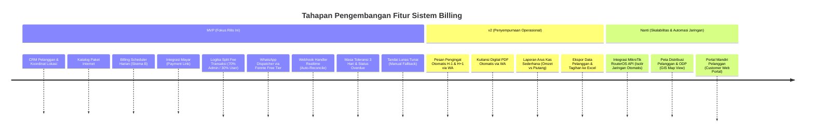
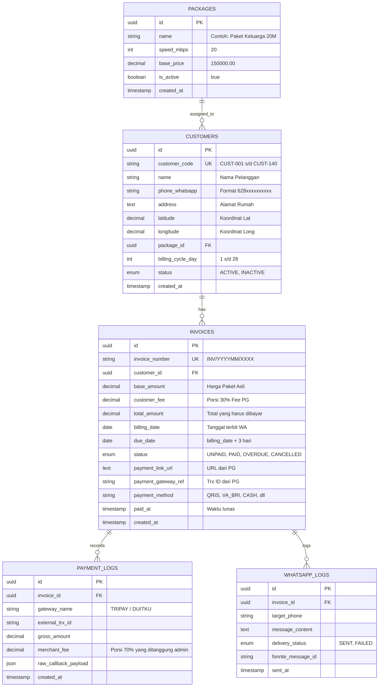

# PRODUCT REQUIREMENT DOCUMENT (PRD)

**Nama Produk:** Sistem Manajemen Pelanggan (CRM) & Billing Otomatis RT/RW Net  
**Versi:** 1.1 (Final MVP Specification)  
**Target Pengguna:** Pengelola Tunggal RT/RW Net Mandiri (~140 Pelanggan)  
**Status:** Approved for Development  

---

### 1. Problem Statement

* **Siapa yang Dirugikan:**
  * **Pengelola Jaringan (Solo Admin):** 1 orang yang merangkap sebagai pemilik, teknisi kabel/router, sekaligus kasir penagihan untuk 140 pelanggan aktif.
  * **Pelanggan RT/RW Net:** Warga perumahan/kampung pengguna layanan internet rumahan.
* **Kenapa Masalah Ini Kritis:**
  * **Inefisiensi Waktu & Beban Mental:** Setiap hari admin harus mengingat siapa saja pelanggan yang jatuh tempo, menyalin format tagihan manual ke WhatsApp pribadi, dan memeriksa mutasi rekening bank satu per satu.
  * **Kebocoran Arus Kas (*Cash Flow*):** Sering terjadi keterlambatan menagih akibat kesibukan teknis di lapangan. Pelanggan yang menunggak sering tidak terdata secara akurat, menimbulkan potensi piutang tak tertagih.
  * **Friksi Pembayaran:** Pelanggan tidak menerima tagihan dengan rincian jelas, repot harus transfer antar-bank atau mencari ATM, lalu wajib mengirimkan tangkapan layar (*screenshot*) bukti transfer dan menunggu admin merespons secara manual.

---

### 2. Target User & Persona

* **Target Segmen:** Usaha mikro internet mandiri (RT/RW Net) berbasis perorangan dengan kapasitas 100–300 pelanggan yang dikelola sendiri (*one-man operation*).

#### Persona 1: Admin / Solo Operator (Primary User)
* **Nama:** Mas Budi (33 tahun)
* **Peran:** Pemilik, Teknisi Jaringan, & Administrator Keuangan.
* **Karakteristik:** Memahami konfigurasi dasar jaringan (MikroTik/ONT), mobilitas tinggi di lapangan, mengoperasikan sistem utamanya melalui ponsel dan laptop pribadi saat rehat.
* **Pain Points:** 
  * Waktu habis untuk mencocokkan mutasi bank dengan chat konfirmasi pembayaran.
  * Canggung dan sungkan menagih berulang kali ke tetangga sendiri secara manual.
  * Takut ada pelanggan yang sudah bayar tapi belum tercatat lunas.
* **Tujuan (Goals):** Sistem yang bekerja sendiri di latar belakang (*autopilot*): tagihan terkirim otomatis tiap tanggal pasang pelanggan, dan data langsung ter-update "Lunas" begitu ada uang masuk di Payment Gateway.

#### Persona 2: Pelanggan Internet Rumahan (End-Customer)
* **Nama:** Bu Ratna (40 tahun)
* **Peran:** Ibu Rumah Tangga / Warga pengguna paket internet keluarga (20 Mbps).
* **Karakteristik:** Menggunakan smartphone untuk kebutuhan sehari-hari, aktif di WhatsApp, terbiasa menggunakan QRIS dan e-wallet (DANA/ShopeePay/GoPay) untuk belanja harian.
* **Pain Points:**
  * Lupa tanggal jatuh tempo WiFi rumah karena tidak ada pemberitahuan tertulis.
  * Malas jika harus transfer manual ke rekening bank lalu mengetik: *"Mas Budi, WiFi rumah Pak RT sudah ditransfer ya"*.
* **Tujuan (Goals):** Menerima notifikasi tagihan resmi di WhatsApp dengan satu tautan pembayaran (*payment link*) instan yang bisa dibayar via QRIS tanpa perlu konfirmasi manual.

---

### 3. Goals & Non-Goals

#### Goals (MVP)
1. **Otomatisasi Penuh Penagihan Harian (Skema B - Anniversary):** Sistem otomatis menerbitkan tagihan dan mengirimkan notifikasi WhatsApp sesuai tanggal aktivasi masing-masing pelanggan (rata-rata terdistribusi ~4–5 pelanggan per hari).
2. **Rekonsiliasi Realtime via Payment Gateway Perorangan:** Integrasi dengan Payment Gateway (Mayar - https://mayar.id) yang memproses pembayaran secara otomatis via *webhook* dari status `UNPAID` menjadi `PAID` dalam hitungan detik.
3. **Efisiensi Beban Biaya Transaksi (Split Fee 70/30):** Sistem secara otomatis menghitung penambahan biaya transaksi PG (30% dibebankan ke invoice pelanggan, 70% diserap oleh margin admin).
4. **Operasional Berbiaya Nol untuk Notifikasi:** Memanfaatkan Fonnte Free Tier secara optimal tanpa melebihi kuota harian karena volume pesan terdistribusi rata sepanjang bulan.
5. **Jatuh Tempo & Masa Toleransi 3 Hari:** Memberikan batas waktu pembayaran 3 hari kalender sebelum status invoice ditandai menunggak (`OVERDUE`).
6. **Eliminasi Cek Mutasi Manual:** Menurunkan keterlibatan admin dalam pencatatan pembayaran digital hingga 100%.

#### Non-Goals (Out of Scope untuk MVP)
1. **TIDAK Ada Integrasi Jaringan / Isolir Otomatis ke Router:** Sistem tidak menghubungkan API ke MikroTik, OLT, atau RADIUS. Penanganan pelanggan menunggak murni berstatus administratif di dashboard.
2. **TIDAK Ada Portal Web / Aplikasi Khusus Pelanggan:** Tidak ada sistem registrasi/login bagi pelanggan; seluruh pengalaman pelanggan murni berbasis pesan WhatsApp dan halaman checkout Payment Gateway.
3. **TIDAK Ada Modul Tiket Gangguan / Helpdesk:** Komplain jaringan tetap berjalan lewat saluran komunikasi langsung seperti biasa.

---

### 4. User Stories

| ID | User Story (Sebagai... Saya ingin... Supaya...) | Prioritas |
| :--- | :--- | :--- |
| **US-01** | **Sebagai Admin**, saya ingin mendaftarkan data pelanggan baru (nama, WA, alamat, koordinat, paket, tanggal pasang) **supaya** seluruh data pelanggan tersimpan rapi dan menjadi basis penagihan otomatis. | P0 |
| **US-02** | **Sebagai Admin**, saya ingin membuat daftar paket internet (kecepatan Mbps, harga bulanan) **supaya** saya dapat menetapkan paket langganan secara konsisten. | P0 |
| **US-03** | **Sebagai Admin**, saya ingin sistem menjalankan pengecekan otomatis setiap jam 08:00 WIB untuk membuat invoice dan tautan bayar bagi pelanggan yang jatuh tempo hari itu **supaya** penagihan berjalan tanpa perlu saya ingat manual. | P0 |
| **US-04** | **Sebagai Pelanggan**, saya ingin menerima notifikasi tagihan via WhatsApp lengkap dengan rincian biaya dan Payment Link resmi **supaya** saya dapat membayar tagihan dengan mudah menggunakan QRIS/e-wallet. | P0 |
| **US-05** | **Sebagai Admin**, saya ingin status invoice otomatis berubah menjadi "LUNAS" begitu webhook pembayaran diterima dari Payment Gateway **supaya** kas tercatat akurat tanpa saya harus mengecek rekening bank. | P0 |
| **US-06** | **Sebagai Admin**, saya ingin memiliki tombol "Tandai Lunas Tunai" pada dashboard **supaya** saya tetap bisa melayani tetangga yang membayar uang tunai langsung ke rumah. | P0 |
| **US-07** | **Sebagai Admin**, saya ingin melihat status tagihan yang melewati batas toleransi 3 hari berubah menjadi "MENUNGGAK" (Overdue) **supaya** saya tahu siapa saja yang belum melunasi kewajibannya. | P0 |

---

### 5. Roadmap Fitur (MVP / v2 / Nanti)



---

### 6. Functional Requirements (Detail per Fitur MVP)

#### FR-1: Manajemen Pelanggan (CRM)
* **FR-1.1:** Form input pelanggan wajib memuat:
  * Nama Lengkap (string, max 100 char)
  * Nomor WhatsApp (string; otomatis dinormalisasi ke format `628xxxxxxxxxx`)
  * Alamat Pemasangan (text)
  * Koordinat Geografis (Latitude & Longitude dalam format desimal untuk pemetaan lokasi)
  * Pilihan Paket Langganan (relasi ke tabel `packages`)
  * Tanggal Siklus Penagihan (`billing_cycle_day`: integer 1–28)
  * Status Akun (`ACTIVE` atau `INACTIVE`)
* **FR-1.2:** Batasan Input Tanggal Pasang: Nilai tanggal siklus dibatasi maksimal tanggal 28 untuk mencegah anomali pada bulan Februari. Jika pelanggan dipasang tanggal 29, 30, atau 31, sistem otomatis mengaturnya ke tanggal 1 (atau 28) sesuai konfirmasi admin.

#### FR-2: Manajemen Paket Internet
* **FR-2.1:** Atribut paket: Nama Paket, Kecepatan (Mbps), Harga Pokok Bulanan (IDR), dan Status Aktif.
* **FR-2.2:** Paket yang masih memiliki pelanggan aktif tidak dapat dihapus permanen, hanya dapat dinonaktifkan agar tidak dipilih pelanggan baru.

#### FR-3: Engine Tagihan Otomatis (Skema B - Anniversary)
* **FR-3.1:** Cron Job dieksekusi setiap hari pada pukul **08:00 WIB**.
* **FR-3.2:** Cron memfilter pelanggan dengan kriteria: `status = 'ACTIVE'` DAN `billing_cycle_day = Tanggal Hari Ini`.
* **FR-3.3:** Formula Tanggal:
  * `billing_date` = Tanggal hari ini saat invoice dibuat.
  * `due_date` = `billing_date` + 3 hari kalender (contoh: Terbit tgl 7 $\rightarrow$ Jatuh tempo tgl 10 pukul 23:59 WIB).
* **FR-3.4:** Penghitungan Split Fee Transaksi (70% Admin / 30% Pelanggan):
  * Biaya standar Payment Gateway (misal QRIS flat ~Rp800 atau 0.7%): diestimasikan sebesar $F$.
  * Porsi Pelanggan (30%): $F_{customer} = \lceil F \times 0.30 \rceil$.
  * Total Tagihan ke Pelanggan: `total_amount` = `package_price` + $F_{customer}$.
  * Porsi Admin (70%): $F \times 0.70$ otomatis terpotong saat penarikan dana dari saldo Payment Gateway.

#### FR-4: Integrasi Payment Gateway (Mayar API)
* **FR-4.1:** Backend meminta pembuatan *Single Payment Request* ke API Mayar dengan masa kedaluwarsa tepat sama dengan `due_date` (3 hari).
* **FR-4.2:** Parameter request: `name`, `amount` (`total_amount`), `description`, `mobile`, `email`, dan `redirectUrl`.
* **FR-4.3:** URL pembayaran yang dikembalikan disimpan pada field `payment_url` dan ID referensi pada `gateway_order_id`.

#### FR-5: Dispatcher WhatsApp (Fonnte Integration)
* **FR-5.1:** Pesan dikirimkan sesaat setelah Payment Link berhasil digenerate melalui API Fonnte (`POST https://api.fonnte.com/send`).
* **FR-5.2:** Format Pesan Baku:
  ```text
  Yth. Bapak/Ibu {nama_pelanggan},

  Berikut tagihan internet WiFi periode {periode_bulan}:
  - Paket: {nama_paket} ({kecepatan} Mbps)
  - Total Tagihan: Rp {total_amount}
  - Batas Pembayaran: {due_date} (3 hari)

  Silakan lakukan pembayaran instan melalui tautan resmi berikut (Bisa QRIS, E-Wallet, atau Transfer Bank):
  {payment_link_url}

  *Pesan ini dikirim otomatis oleh sistem billing. Pembayaran akan terkonfirmasi secara instan tanpa perlu mengirim bukti transfer.*
  Terima kasih.
  ```
* **FR-5.3:** Volume Throttling: Mengingat Skema B membagi 140 pelanggan dalam sebulan, sistem hanya mengirim rata-rata 4–6 pesan per hari, aman dari limit pengiriman Fonnte Free Tier.

#### FR-6: Webhook & Rekonsiliasi Otomatis
* **FR-6.1:** Endpoint `POST /api/webhooks/payment` siap menerima notifikasi event dari PG.
* **FR-6.2:** Verifikasi Signature: Sistem menghitung hash signature (HMAC-SHA256) dari payload dan mencocokkannya dengan *Private Key* akun PG. Jika tidak cocok, tolak request (HTTP 401).
* **FR-6.3:** Jika status dari PG adalah `PAID` / `SETTLEMENT`:
  * Ubah status invoice dari `UNPAID` menjadi `PAID`.
  * Isi field `paid_at` dengan timestamp realtime.
  * Catat metode pembayaran spesifik (contoh: `QRIS`, `VA_BCA`, `INDOMARET`).
* **FR-6.4:** Idempoten: Jika webhook yang sama terkirim berulang kali oleh server PG, sistem hanya mengeksekusi update status satu kali.

#### FR-7: Transisi Status Overdue & Manual Cash Fallback
* **FR-7.1:** Cron harian jam 00:05 WIB memeriksa seluruh invoice berstatus `UNPAID` yang telah melewati `due_date`. Status otomatis diperbarui menjadi `OVERDUE`.
* **FR-7.2:** Fitur Bayar Tunai: Pada baris data invoice di dashboard, admin dapat mengklik tombol *"Terima Tunai"*. Sistem meminta konfirmasi lalu mengubah status menjadi `PAID`, mengisi `paid_at`, dan memberi catatan `payment_method = 'CASH'`.

---

### 7. Sketsa Data Model



---

### 8. Edge Cases & Failure States

1. **Koneksi Akun Fonnte Terputus (Device Disconnected):**
   * *Masalah:* Sesi WhatsApp Web di Fonnte logout atau ponsel admin mati, sehingga pesan tagihan gagal terkirim.
   * *Mitigasi:* Sistem mencatat status `FAILED` pada `WHATSAPP_LOGS`. Pada header dashboard admin ditampilkan indikator status koneksi Fonnte (Hijau = Connected, Merah = Disconnected). Pada baris invoice terkait, muncul tombol *"Kirim Ulang WA"* dan *"Salin Link Pembayaran"* agar admin bisa membagikan link secara manual jika darurat.
2. **Pelanggan Membayar Setelah Lewat 3 Hari (Link Expired):**
   * *Masalah:* Pelanggan baru mengklik tautan di hari ke-4, dan Payment Gateway menolak transaksi karena waktu sewa link telah habis.
   * *Mitigasi:* Halaman web checkout PG akan mengarahkan pelanggan bahwa link kedaluwarsa. Di dashboard admin, status invoice tetap `OVERDUE`. Disediakan tombol *"Perpanjang & Kirim Ulang Link"* yang akan membuat transaksi baru ke PG untuk 3 hari ke depan.
3. **Kegagalan Pengiriman Webhook oleh Payment Gateway:**
   * *Masalah:* Pelanggan sudah berhasil bayar di kasir Alfamart/QRIS, tetapi koneksi internet server aplikasi sedang terganggu sehingga webhook tidak masuk.
   * *Mitigasi:* Disediakan tombol *"Cek Status Manual"* pada detail invoice di dashboard. Backend akan langsung menembak API status PG (`GET /transaction/detail/{ref}`) untuk menarik data pelunasan dan mengubah status invoice menjadi `PAID`.
4. **Pembayaran Ganda (Bayar Tunai & Bayar via QRIS bersamaan):**
   * *Masalah:* Pelanggan menitipkan uang tunai ke admin di jalan, admin menandai "Lunas Tunai", lalu 10 menit kemudian anak pelanggan membayar via QRIS.
   * *Mitigasi:* Jika webhook masuk untuk invoice yang statusnya sudah `PAID (CASH)`, webhook tidak akan menolak transaksi (agar saldo PG tetap masuk), melainkan mencatatnya di log dan memunculkan badge peringatan mencolok di dashboard: `PERINGATAN: PEMBAYARAN GANDA - Perlu Refund Tunai ke Pelanggan`.

---

### 9. Success Metrics

| Indikator Kinerja (KPI) | Target Sukses (Bulan 1–2) | Tolok Ukur Evaluasi |
| :--- | :--- | :--- |
| **Otomatisasi Penagihan** | **100% Tepat Waktu** | Tidak ada pelanggan aktif yang terlewat dari pembuatan invoice harian jam 08:00 WIB. |
| **Adopsi Pembayaran Digital** | **$\ge$ 70% Pelanggan** | Minimal 100 dari 140 pelanggan membayar via link (QRIS/VA) tanpa setor tunai. |
| **Beban Waktu Admin** | **Turun > 95%** | Waktu rekapitulasi pembayaran berkurang dari ~10 jam/bulan menjadi < 30 menit/bulan. |
| **Tingkat Kegagalan WhatsApp** | **< 2% Error Rate** | Rasio pesan gagal kirim di Fonnte tidak melebihi 3 pesan dari total 140 pengiriman per bulan. |
| **Akurasi Rekonsiliasi Kas** | **100% Sinkron** | Seluruh transaksi berstatus `PAID` di aplikasi cocok mutlak dengan mutasi settlement di akun Payment Gateway. |

---

### 10. Open Questions & Prasyarat Teknis (Sebelum Coding Dimulai)

Seluruh requirement utama sudah terkunci. Berikut 3 langkah prasyarat operasional yang harus disiapkan oleh Anda (Admin):

1. **Pemilihan & Pendaftaran Vendor PG:**
   * Anda disarankan mendaftar akun perorangan di **Mayar.id** (sangat ramah akun individu/UMKM, verifikasi cepat dengan KTP & buku tabungan). Dapatkan `API Key` dan atur webhook destination di dashboard Mayar.
2. **Koneksi Akun Fonnte Free:**
   * Buat akun di **Fonnte.com**, lalu lakukan pemindaian (*scan QR*) nomor WhatsApp yang akan digunakan sebagai nomor resmi pengirim tagihan. Catat `API Token` yang diberikan Fonnte untuk dimasukkan ke konfigurasi sistem.
3. **Penyediaan Server / Hosting Webhook:**
   * Karena Payment Gateway membutuhkan alamat URL publik untuk mengirimkan webhook (contoh: `https://billing.namawifi.com/api/webhooks/payment`), aplikasi backend ini wajib di-deploy di VPS/hosting publik (atau menggunakan tunnel seperti Ngrok/Cloudflare Tunnel saat masa testing lokal).
